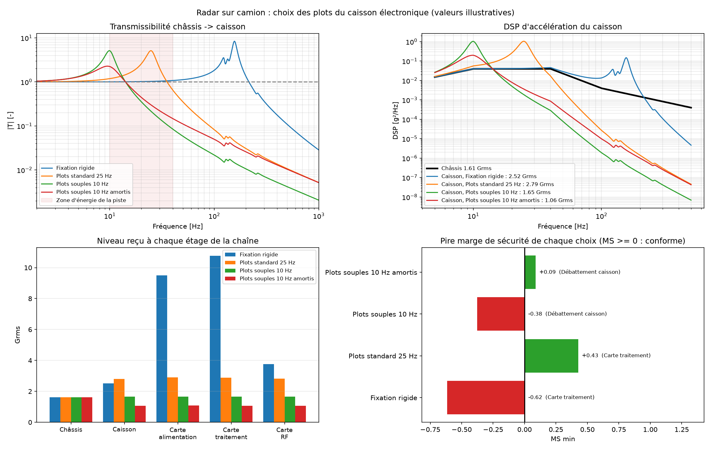
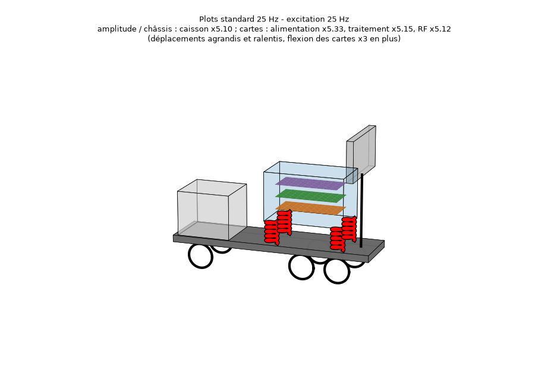
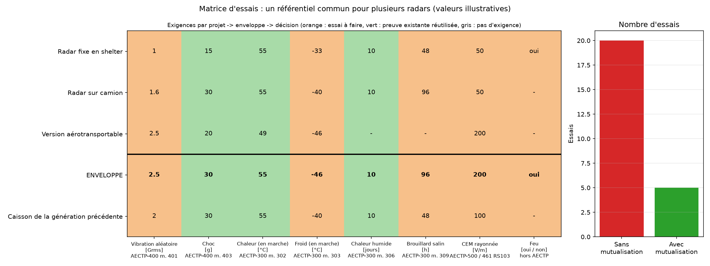
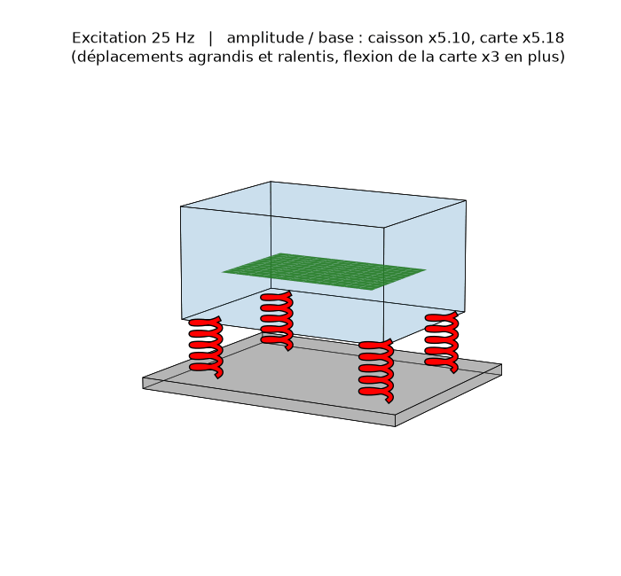

# Maquette vibratoire et qualification environnementale

Des modèles Python courts pour prédire ce que subit l'électronique d'un radar quand son porteur vibre, puis pour organiser les essais de qualification de plusieurs projets.

> Toutes les valeurs sont **illustratives** : ce ne sont pas des données Thales.

## En bref : le cas radar sur camion



- **Problème.** Un caisson électronique est monté sur un camion radar. Quels plots (silentblocs) choisir pour que les 3 cartes tiennent, sans que le caisson tape contre la structure ?
- **Méthode.** On suit la chaîne piste → châssis → plots → caisson → cartes. La fréquence des cartes est calculée comme celle d'une plaque. On vérifie trois critères : la tenue des cartes (Steinberg), le débattement du caisson et la règle de l'octave.
- **Conclusion.** Des plots à 25 Hz **amplifient** sur camion, car l'énergie de la piste est entre 10 et 40 Hz. Des plots à 10 Hz isolent, mais ils doivent être **amortis**, sinon le caisson tape. Sans plots, le mode du caisson se couple avec les cartes, qui cassent.

## Les fichiers

| Fichier | Rôle |
|---|---|
| `maquette.py` | Le modèle de base : un caisson sur silentblocs et une carte. Les données sont en haut du fichier. |
| `radar_camion.py` | **Exemple principal** : radar sur camion, 3 cartes, comparaison de 4 choix de plots. |
| `recalage.py` | Recale le modèle sur un essai au pot vibrant par descente de gradient (essai simulé). |
| `matrice_essais.py` | Mutualisation des essais de 3 projets : enveloppe des exigences, preuves réutilisables, nombre d'essais évités. |
| `visualisation_3d.py` | Animation 3D de la maquette, avec un curseur de fréquence. |
| `visualisation_radar_3d.py` | Animation 3D du camion radar, avec un curseur de fréquence et des boutons pour choisir les plots. |
| `maquette.cpp` | Le même calcul que `maquette.py`, en C++. |
| `fiche_entretien.md` | Les questions probables, les questions pièges et leurs réponses. |
| `resultats/` | Les sorties, recréées à chaque lancement. |

Le code est volontairement **le plus simple possible** :
- seulement `numpy` et `matplotlib` ;
- un fichier par sujet, qui se lit de haut en bas : données, calcul, note de calcul, figure ;
- les données sont de simples listes en haut du fichier, par exemple `caisson = [masse, fréquence, amortissement]`.

Le calcul tient en une ligne : `(K − ω²M + iωC) z = −M·1·a`, résolue à chaque fréquence. Ici z est le déplacement de chaque pièce par rapport à la base.

## Installation et lancement

Pour créer l'environnement, une seule fois :

```bash
python -m venv .venv
```

```bash
.venv\Scripts\python.exe -m pip install numpy matplotlib pyqt6 spyder-kernels
```

**Dans Spyder** : ouvrir un fichier, puis appuyer sur **F5**. L'interpréteur doit être `.venv\Scripts\python.exe` (*Outils → Préférences → Interpréteur Python*). Pour les animations 3D, régler *Préférences → Console IPython → Graphiques → Sortie graphique* sur **Automatique**.

**En ligne de commande** :

```bash
.venv\Scripts\python.exe radar_camion.py
```

**Version C++** :

```bash
g++ -O2 -o maquette.exe maquette.cpp
```

```bash
maquette.exe
```

Elle donne exactement les mêmes chiffres que `maquette.py`.

## Les critères vérifiés

Pour chaque critère, on calcule une marge de sécurité **MS = admissible / calculé − 1**. Pour la séparation des modes, qui est un minimum, MS = calculé / minimum − 1. Le critère est conforme si MS ≥ 0.

| Critère | Question posée | Convention |
|---|---|---|
| Séparation des modes | La carte vibre-t-elle au moins 2 fois plus haut que la suspension (règle de l'octave) ? | f carte / f suspension ≥ 2 |
| Débattement des silentblocs | Le caisson risque-t-il de taper contre la structure ? | **4σ** : sur une heure d'essai, le plus grand pic atteint environ 4σ (loi de Rayleigh) |
| Flexion de la carte (Steinberg) | Les soudures des composants vont-elles casser par fatigue ? | **3σ au centre de la carte**, Z = 0,00022·B / (C·h·r·√L), en pouces |

**Flexion au centre de la carte.** Une carte réduite à une masse sur un ressort donne son déplacement « moyen » (modal). Au centre d'une plaque en appui sur ses 4 bords, la flexion est **16/π² ≈ 1,62** fois plus grande. Le code applique ce facteur.

**Vérification du code.** Le programme vérifie d'abord un cas dont on connaît la réponse exacte : un oscillateur simple sous bruit blanc, avec Grms² = S0·π·fn·(1+4ζ²)/(4ζ). L'écart obtenu est de 3·10⁻⁵. La formule de **Miles**, Grms ≈ √(π/2·fn·Q·S0), en est l'approximation pour un amortissement faible.

## Résultats de `maquette.py` (cas nominal)

Le caisson pèse 25 kg et repose sur des silentblocs à 25 Hz. La carte mesure 160 × 100 × 2 mm, pèse 0,25 kg et vibre à 200 Hz. L'entrée est un profil de 6 Grms.

| | Valeur |
|---|---|
| Modes | 25,0 Hz (le caisson sur ses silentblocs) et 201,0 Hz (la carte) |
| Niveaux | entrée 6,06 Grms → caisson 1,47 Grms → carte 1,56 Grms |
| Débattement 4σ | 2,27 mm pour un jeu de 5 mm (MS = +1,20) |
| Flexion de la carte 3σ | 0,047 mm pour 0,451 mm admissibles (MS = +8,6) |
| Pire cas de sensibilité | amortissement faible (5 %) : MS = +0,49, toujours conforme |

**Sensibilité.** Le calcul est refait au chaud (−30 % de raideur des silentblocs), au froid (+50 %), puis avec 5 % et 20 % d'amortissement.

Sorties : `resultats/rapport.txt` (note de calcul) et `resultats/synthese.png` (4 graphiques).

## Radar sur camion (`radar_camion.py`)

L'antenne est sur un mât. L'électronique est rangée dans des caissons posés sur des plots. Quand le camion roule sur une piste, les vibrations suivent cette chaîne :

```
piste → châssis du camion → plots → caisson électronique → cartes (alimentation, traitement, RF)
        (ENTRÉE : profil de piste)  (filtrent ou amplifient)   (chacune a sa propre résonance)
```

**Les cartes** sont modélisées comme des plaques FR4 en appui simple sur leurs 4 bords. Leur fréquence est **calculée** à partir de leurs dimensions (Techniques de l'Ingénieur E3954) : fn = π/2 · √(D/ρh) · (1/a² + 1/b²), avec D = Eh³/12(1−ν²). La constante C de Steinberg dépend du boîtier du plus gros composant :

| Carte | Dimensions | Fréquence calculée | Boîtier (C) | Flexion 3σ admissible |
|---|---|---|---|---|
| Alimentation | 160 × 100 × 2,0 mm, 0,60 kg | 127 Hz | à broches (1,0) | 0,41 mm |
| Traitement | 233 × 160 × 2,4 mm, 0,35 kg | 137 Hz | BGA (1,75) | 0,26 mm |
| RF | 100 × 80 × 2,0 mm, 0,25 kg | 255 Hz | céramique sans broches (2,25) | 0,14 mm |

**Résultats** (profil de piste à 1,6 Grms, jeu de 10 mm autour du caisson) :

| Choix de plots | Caisson | Pire carte | Débattement 4σ | Pire marge | Verdict |
|---|---|---|---|---|---|
| Fixation rigide | 2,5 Grms | **10,8 Grms** (traitement) | 0,1 mm | −0,62 | **Non conforme** : le caisson (≈ 150 Hz) est sous l'octave des cartes (127 et 137 Hz), les modes se couplent |
| Plots standard 25 Hz | **2,8 Grms** | 2,9 Grms | 4,4 mm | +0,43 (carte traitement) | Conforme, mais les plots **amplifient** |
| Plots souples 10 Hz | 1,7 Grms | 1,7 Grms | **16 mm** | −0,38 | **Non conforme** : le caisson tape |
| Plots souples 10 Hz amortis (25 %) | 1,1 Grms | 1,1 Grms | 9,2 mm | +0,09 (débattement) | Conforme de justesse, cartes les mieux protégées |

**Les leçons à retenir :**
1. **Des plots ne sont pas « bons » ou « mauvais » dans l'absolu.** Des plots à 25 Hz isolent bien sur un avion, dont l'énergie est à haute fréquence, mais ils amplifient sur un camion. Il faut toujours partir du **profil de vie** (AECTP-100).
2. **Deux modes proches se couplent.** Sans plots, la carte traitement reçoit 6,7 fois le niveau du châssis. C'est la règle de l'octave, vue en pratique.
3. **Le choix final est un compromis.** Des plots souples protègent les cartes mais demandent du jeu autour du caisson. Ici, la solution amortie ne laisse que 9 % de marge sur le jeu : il faudrait soit un peu plus de jeu, soit des butées.

Sorties : `resultats/radar_camion_rapport.txt` et `resultats/radar_camion.png`.

**Animation 3D** : `visualisation_radar_3d.py` (F5). Le curseur change la fréquence et les boutons à gauche changent les plots.

| Réglage | Ce qu'on voit |
|---|---|
| Plots 25 Hz, curseur sur 25 Hz | le caisson rebondit sur ses plots (×5) |
| Plots 10 Hz amortis, curseur sur 25 Hz | le caisson reste presque immobile (×0,3) |
| Fixation rigide, curseur sur 135 Hz | les cartes alimentation (orange) et traitement (verte) fléchissent très fortement |



## Matrice d'essais (`matrice_essais.py`)

C'est la mission « standardiser le référentiel » de l'offre. Trois projets fictifs (radar fixe en shelter, radar sur camion, version aérotransportable) ont chacun leurs exigences : vibration, choc, chaud, froid, humidité, brouillard salin, CEM et feu.

1. Le programme prend l'**enveloppe** : le cas le plus sévère de chaque environnement.
2. Il compare cette enveloppe à ce qu'un **produit déjà qualifié** a déjà tenu. Si c'est couvert, la preuve est réutilisée (qualification par similitude, à justifier : même conception, mêmes matériaux).
3. Il compte les essais : **20 sans mutualisation, 5 avec**.
4. Il propose une séquence sur une seule éprouvette : la mécanique d'abord, le brouillard salin en dernier, et le feu à part car c'est un essai destructif.



Les numéros de méthode AECTP (401, 403, 302, 303, 306, 309) sont à vérifier dans l'édition en vigueur. Le feu n'est pas couvert par l'AECTP-300 : il demande une exigence spécifique.

## Recalage modèle-essai (`recalage.py`)

La fiche technique annonce des silentblocs à 25 Hz et 10 % d'amortissement, mais le vrai produit est différent. On le mesure au pot vibrant, puis on ajuste le modèle pour qu'il colle à la mesure.

| Notion du cours | Dans `recalage.py` |
|---|---|
| Paramètres θ | fréquence et amortissement des silentblocs (normalisés autour de 1) |
| Perte J (MSE avec le facteur ½) | écart entre la transmissibilité du modèle et celle mesurée (en log) |
| Descente de gradient θ ← θ − α∇J | la boucle `for` du fichier, avec un pas α = 0,5 |
| Critère d'arrêt ‖α∇J‖ < ε | ε = 10⁻⁷ |
| Jeu d'entraînement / jeu de test | 70 % des points servent à recaler, 30 % à juger le résultat |

Le gradient est calculé par **différences finies**. Avec seulement 2 paramètres, cela suffit.

**Résultat** (essai simulé, avec un vrai caisson caché et 5 % de bruit) :

| | Fiche technique | Recalé | Vrai (caché) |
|---|---|---|---|
| Fréquence | 25,0 Hz | 22,2 Hz | 22,0 Hz |
| Amortissement | 10 % | 14,1 % | 14 % |

- La perte sur le jeu de test passe de 9,6·10⁻³ à 1,4·10⁻⁴.
- La pire marge de sécurité passe de +1,20 à +1,60.

**Limite.** Les points de test viennent du même balayage que les points de recalage : c'est surtout de l'interpolation. Une vraie validation se fait sur un **autre essai** (autre niveau, autre axe ou autre exemplaire). En pratique, on utiliserait aussi une méthode plus rapide (Gauss-Newton, Levenberg-Marquardt).

## Visualisation 3D de la maquette (`visualisation_3d.py`)

La base vibre, les 4 silentblocs se déforment, le caisson monte et descend, et la carte (en vert) fléchit en cuvette. Le **curseur** change la fréquence d'excitation, de 5 à 300 Hz.

| Fréquence | Ce qu'on voit |
|---|---|
| ~25 Hz | Résonance de la suspension : le caisson bouge 5 fois plus que la base |
| ~60 Hz | Isolation : le caisson bouge beaucoup moins que la base |
| ~200 Hz | Le caisson est presque immobile, mais la carte vibre (sa propre résonance) |

Les déplacements sont agrandis et ralentis pour être visibles. Si la fenêtre reste figée, régler la sortie graphique de Spyder sur **Automatique**. Pour refaire un GIF, taper dans la console après F5 : `enregistrer_gif(25, "resultats/animation_25Hz.gif")`.



## Limites et suite

- **Modèle** : un seul axe, des masses ponctuelles, un comportement linéaire. Un élastomère est plutôt hystérétique et se raidit au froid.
- **Suite logique** : un modèle éléments finis du caisson en 3D, puis un essai au pot vibrant (balayage sinus à bas niveau) pour recaler les fréquences et les amortissements.
- **Autres environnements** : un choc demi-sinus pourrait faire taper des plots souples, même s'ils sont bons en vibration. La qualification doit donc couvrir tous les environnements à la fois.
