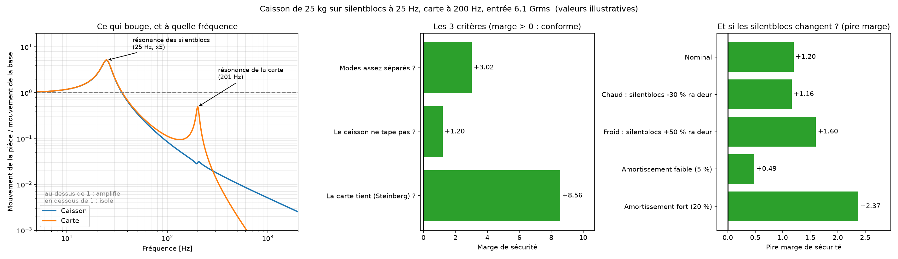
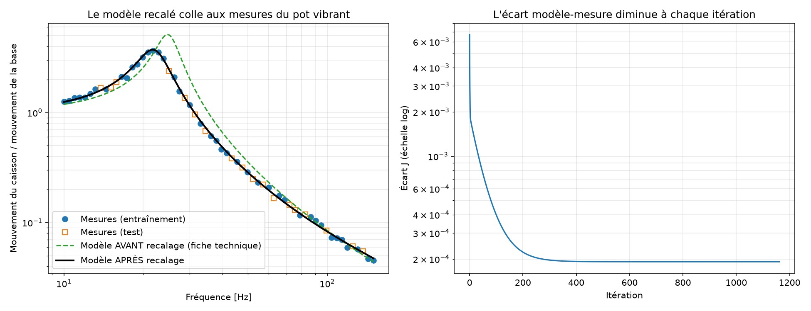

# Maquette vibratoire d'un caisson électronique

Petit projet Python que j'ai fait pour préparer un stage en qualification environnementale (radars de défense aérienne). Il répond à une question concrète de bureau d'études :

> **Quand le porteur vibre (camion, avion, shelter), l'électronique à l'intérieur du caisson va-t-elle tenir ? Et comment organiser les essais pour le prouver sans tout refaire pour chaque projet ?**

Toutes les valeurs sont **illustratives** : aucune donnée Thales.

## Le dépôt en une image

```
 piste / porteur  ──►  châssis  ──►  plots (silentblocs)  ──►  caisson  ──►  cartes électroniques
   (ENTRÉE :                          filtrent ou                            chacune a sa propre
    profil de vibration)              amplifient                             résonance et peut casser
```

Chaque étage est une masse sur un ressort avec un amortisseur. Je résous, fréquence par fréquence, l'équation du mouvement, puis je vérifie trois critères simples :

| Critère | Question posée | Conforme si |
|---|---|---|
| Règle de l'octave | Les cartes vibrent-elles assez loin de la suspension ? | f carte ≥ 2 × f plots |
| Débattement | Le caisson risque-t-il de taper la structure ? | déplacement 4σ < jeu disponible |
| Steinberg | Les soudures des composants vont-elles fatiguer ? | flexion 3σ de la carte < admissible |

Chaque critère donne une **marge de sécurité** (MS). MS > 0 : conforme. MS < 0 : non conforme.

## Les 4 résultats à regarder

### 1. Choisir les plots d'un radar sur camion (`radar_camion.py`)


Quatre choix de plots sous le même caisson, trois cartes dedans. Ce que j'en retire :
- **Sans plots**, le caisson résonne vers 150 Hz, juste à côté des cartes (127 et 137 Hz) : elles reçoivent 7 fois le niveau du châssis et cassent.
- **Des plots à 25 Hz** tombent dans la zone où la piste secoue le plus (10 à 40 Hz) : ils **amplifient** au lieu d'isoler. Conforme, mais pas pour la bonne raison.
- **Des plots à 10 Hz** protègent bien les cartes, mais le caisson tape (16 mm de débattement pour 10 mm de jeu). Il faut les **amortir** pour que ça passe.

Le bon choix dépend donc du **profil de vie** du matériel, pas d'une recette.

### 2. Le modèle de base (`maquette.py`)



Un caisson de 25 kg sur silentblocs à 25 Hz et une carte à 200 Hz. La figure montre, de gauche à droite : ce qui bouge et à quelle fréquence, les trois critères, puis la robustesse si les silentblocs changent avec la température ou l'amortissement. Tout reste conforme, le pire cas étant l'amortissement faible.

### 3. Mutualiser les essais de plusieurs projets (`matrice_essais.py`)


Trois radars fictifs ont chacun leurs exigences (vibration, choc, chaud, froid, humidité, sel, CEM, feu). Je prends l'**enveloppe** (le plus sévère de chaque colonne), je regarde ce qu'un ancien caisson a déjà prouvé, et je compte : **20 essais si chaque projet teste seul, 5 avec un référentiel commun**.

### 4. Recaler le modèle sur un essai (`recalage.py`)



La fiche technique dit 25 Hz et 10 % d'amortissement, le vrai produit fait 22 Hz et 14 %. À partir de mesures (simulées) au pot vibrant, une descente de gradient retrouve les bonnes valeurs. C'est la phase « validation et recalage du modèle » de l'offre.

## Les fichiers

| Fichier | Rôle |
|---|---|
| `maquette.py` | Modèle de base : caisson + 1 carte, 3 critères, sensibilité. Les données sont en haut du fichier. |
| `radar_camion.py` | Exemple principal : 3 cartes, 4 choix de plots. |
| `matrice_essais.py` | Enveloppe des exigences, preuves réutilisables, nombre d'essais. |
| `recalage.py` | Recalage modèle-essai par descente de gradient. |
| `visualisation_3d.py`, `visualisation_radar_3d.py` | Animations 3D avec un curseur de fréquence (les GIF sont dans `resultats/`). |
| `maquette.cpp` | Le calcul de `maquette.py` refait en C++ : mêmes chiffres. |
| `resultats/` | Figures, animations et notes de calcul en texte, recréées à chaque lancement. |

Code volontairement simple : seulement `numpy` et `matplotlib`, un fichier par sujet qui se lit de haut en bas (données, calcul, note de calcul, figure).


## Lancer

```bash
python -m venv .venv
```

```bash
.venv\Scripts\python.exe -m pip install numpy matplotlib pyqt6
```

```bash
.venv\Scripts\python.exe radar_camion.py
```

Dans Spyder : ouvrir un fichier, F5. Pour les animations 3D, régler la sortie graphique sur **Automatique** (Préférences → Console IPython → Graphiques).

Version C++ : `g++ -O2 -o maquette.exe maquette.cpp` puis `maquette.exe`.

## Ce que le modèle ne fait pas

Un seul axe, des masses ponctuelles, un comportement linéaire, des données inventées. La suite logique serait un modèle éléments finis 3D du caisson, puis un essai au pot vibrant pour recaler les fréquences et les amortissements.

## Comment j'ai travaillé

J'ai construit ce projet à partir de mes cours de dynamique des structures (ECAM, Polimi) et de documents de référence : Techniques de l'Ingénieur E3954 pour la fréquence des cartes, Steinberg et la courbe RD-N d'Irvine pour la tenue des composants, les normes AECTP pour la matrice d'essais. Je me suis fait aider par Claude (l'assistant d'Anthropic) pour écrire et relire le code, mettre en forme les figures et structurer ce document. Les choix de modélisation, les ordres de grandeur et les conclusions sont les miens, et je sais les expliquer ligne par ligne.
